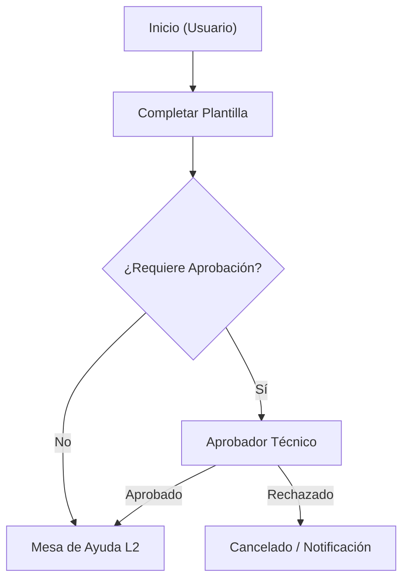

# InvGate Technical & Operational Documentation

This skill guides the creation and refinement of clear, concise, and structured documentation for InvGate Service Management. Output follows strict Notion-compatible GitHub Flavored Markdown.

## Core Principle: Modular Solutions

InvGate solutions are not one-size-fits-all:
* **Standalone Templates**: An HTML template (`invgate-templates`) can be the complete and sufficient solution for a helpdesk queue without needing a new workflow or catalog category.
* **Standalone Workflows**: An `.sdw` workflow (`invgate-workflows`) can automate background routing or integrations without modifying catalog structures.
* **Standalone Catalog Items**: A category definition (`invgate-catalog`) can organize service queues using standard ticket types.
* **Combined Architectures**: Integrated solutions linking categories, forms, templates, and workflows.

**Rule**: Document only what is built. Never invent or require unnecessary workflows or catalog layers if an isolated template or category solves the business need.

---

## Language & Style Guidelines

### 1. Plain & Concise Technical Style
* Apply ASD-STE100 principles: active voice, imperative instructions ("Select", "Configure", "Verify"), sentences under 20 words where possible.
* **Zero fluff**: Eliminate generic filler ("It is important to note that", "Basically", "As we can see").
* Replace vague statements with precise attributes and states.
  * ❌ *Vague*: "The ticket moves forward when approved."
  * ✅ *Precise*: "When the manager approves (`next_accepted`), the request transitions to `Open` and assigns to `TI Soporte L2`."

### 2. Platform-Native Vocabulary
Always use official InvGate Service Management terminology:

| Prefer Official Term | Avoid Generic Term |
|---|---|
| Mesa de Ayuda / Help Desk | Departamento / Área / Cola |
| Grupo de Asignación / Nivel | Sub-equipo / Cuadrilla |
| Categoría Hoja | Carpeta final / Opción |
| Solicitud de Servicio / Incidente | Ticket genérico |
| Plantilla de Descripción (HTML) | Formulario web / Texto plano |
| Flujo de Trabajo (.sdw) | Diagrama / Macro |
| Variable de Proceso | Campo temporal / Variable global |
| Transición de Estado | Cambio de paso / Avance |
| SLA de Respuesta / Resolución | Plazo / Tiempo límite |

---

## Notion & Markdown Formatting Rules

All documents must paste cleanly into **Notion** and render perfectly in **GitHub**:

1. **Headings**: Use `#` for title, `##` for main sections, `###` for sub-sections. Never skip levels.
2. **Callouts**: Use blockquotes `>` with standard alert tokens (`> [!NOTE]`, `> [!IMPORTANT]`, `> [!WARNING]`). Notion converts these to Callout blocks.
3. **Tables**: Use GFM tables for permissions, matrices, decision criteria, and parameters.
4. **Screenshots**: Mark missing or required UI screenshots with standardized callouts:
   ```markdown
   > 📸 *[Captura: Pantalla de Configuración de Mesa de Ayuda > Pestaña Permisos]*
   ```
5. **Diagrams**: Use standard fenced `mermaid` code blocks (`flowchart TD` or `flowchart LR`).
6. **No Raw IDs**: Never expose database IDs (e.g., `category_id: 531`) in end-user sections; use human-readable labels and reserve IDs for Technical/Admin references.

---

## Documentation Archetypes

### Archetype 1: Standard Operating Procedure (SOP) / KB Article
**Audience**: End Users, Service Desk Agents (L1/L2).  
**Tone**: Direct, instructional, accessible.

```markdown
# [SOP / KB] [Nombre de la Acción o Procedimiento]

> [!NOTE]
> **Audiencia**: [Usuarios finales / Agentes L1]  
> **Categoría InvGate**: [Ruta de Categoría Hoja]  
> **Tiempo estimado**: [X minutos]

## 1. Propósito y Cuándo Aplicar
[1-2 oraciones directas explicando qué resuelve este procedimiento].

## 2. Prerrequisitos
* [Permiso, rol o dato necesario antes de iniciar]

## 3. Procedimiento Paso a Paso
1. **Acceder a la solicitud**: Navegar a `Catálogo de Servicios > [Ruta]`.
   > 📸 *[Captura: Vista del Catálogo destacando la opción]*
2. **Completar datos obligatorios**:
   * **[Campo 1]**: [Instrucción concisa].
   * **[Campo 2]**: [Instrucción concisa].
3. **Enviar y Confirmar**: Pulsar **Crear Solicitud**.

## 4. Tiempos de Respuesta y Escalamiento
| Prioridad | SLA Primera Respuesta | SLA Resolución | Mesa Responsable |
|---|---|---|---|
| [Media / Alta] | [X horas] | [Y horas] | [Nombre Mesa] |

## 5. Preguntas Frecuentes
* **¿Qué hacer si [problema común]?**: [Acción directa].
```

---

### Archetype 2: Technical Solution Handover (Runbook)
**Audience**: InvGate Administrators, DevOps, TI Leads.  
**Tone**: Technical, architectural, rigorous.

```markdown
# [Ficha Técnica] [Nombre de la Solución]

> [!NOTE]
> **Tipo de Solución**: [Plantilla Aislada / Workflow .sdw / Categoría / Híbrido]  
> **Mesa Responsable**: [Nombre de la Mesa]  
> **Versión**: [1.0.0]

## 1. Arquitectura de la Solución
[Breve descripción de cómo se resuelve la necesidad. Aclarar si es una plantilla independiente o requiere automatización].



## 2. Componentes y Matriz de Configuración
| Componente | Tipo | Ubicación / Referencia | Rol / Detalle |
|---|---|---|---|
| [Nombre Plantilla] | Plantilla HTML | `Mesa > Plantillas` | Estructura de captura con campos `<p>` |
| [Campo Personalizado] | Texto / Lista | Global / Mesa | Valida formato requerido |

## 3. Matriz de Permisos y Responsables (RACI)
| Paso / Estado | Mesa / Grupo | Rol Requerido | Acción |
|---|---|---|---|
| Creación | [Todos / Grupo X] | Usuario Final | Envío inicial |
| Resolución | [Mesa Soporte L2] | Agente | Diagnóstico y solución |

## 4. Variables y Automatizaciones (si aplica)
| Variable / Campo | Tipo | Origen | Uso / Destino |
|---|---|---|---|
| `{{var_nombre}}` | Texto | Paso 1 | Título de ticket hijo |

## 5. Procedimiento de Contingencia y Rollback
1. Desvincular plantilla o workflow desde `Configuración > Catálogo`.
2. Asignar categoría temporal a mesa de contingencia `[Mesa]`.
```

---

### Archetype 3: Architectural Decision Record (ADR) & Changelog
**Audience**: TI Architects, Admins, Project Managers.  
**Tone**: Justified, evaluative, historical.

```markdown
# [ADR] [Título de la Decisión: ej. Adopción de Plantilla Aislada vs Workflow]

> **Estado**: [Aprobado / Reemplazado / En Evaluación]  
> **Fecha**: [YYYY-MM-DD]  
> **Autor**: [Nombre / Equipo]

## 1. Contexto y Problema
[Descripción del requerimiento operativo y limitaciones identificadas].

## 2. Decisión
Optar por **[Solución elegida, ej. Plantilla HTML con campos fijos]** en lugar de **[Alternativa descartada, ej. Workflow .sdw multinivel]**.

## 3. Comparativa de Alternativas
| Criterio | Opción A: Plantilla Aislada | Opción B: Workflow Complejo |
|---|---|---|
| Tiempo de despliegue | Inmediato (< 1 día) | 2 semanas |
| Mantenimiento | Bajo (edición en UI) | Medio (edición .sdw y empaquetado) |
| Automatización requerida | Nula (solo estandarizar captura) | Alta (despacho a múltiples mesas) |

## 4. Consecuencias
* **Positivas**: Reducción de fricción para agentes y puesta en marcha inmediata.
* **Limitaciones**: No bloquea campos condicionales en backend.

## 5. Registro de Cambios (Changelog)
| Versión | Fecha | Autor | Descripción del Cambio |
|---|---|---|---|
| 1.0.0 | [Fecha] | [Autor] | Creación inicial de la plantilla |
```

---

### Archetype 4: Diagnosis & Improvement Proposal
**Audience**: Service Managers, TI Leads.  
**Tone**: Analytical, proactive, prioritized.

```markdown
# [Propuesta de Mejora] Optimización de [Proceso / Mesa / Flujo]

## 1. Diagnóstico Actual
* **Cuello de botella identificado**: [Descripción precisa].
* **Impacto en métricas**: Aumento del tiempo medio de resolución (MTTR) en [X]%.

## 2. Matriz de Hallazgos y Oportunidades
| Proceso / Paso Actual | Problema Detectado | Propuesta de Solución | Impacto Estimado |
|---|---|---|---|
| [Nombre Paso] | Datos incompletos al crear | Implementar Plantilla HTML estricta | -40% re-preguntas |
| [Aprobación manual] | Espera excesiva de firma | Regla de auto-aprobación por monto | -2 días en ciclo |

## 3. Plan de Acción Recomendado
1. **Fase 1 (Inmediata)**: Desplegar plantilla HTML con títulos `#3498db` y notas explicativas.
2. **Fase 2 (Mediano Plazo)**: Configurar automatización de cierre en estado `Resuelto`.
```
