# InvGate Workflows - Mermaid Diagramming Standard

This guide defines the official specification for generating visual representations of InvGate Service Management workflows in Mermaid format. Whenever a visual diagram of an `.sdw` workflow, process flow, or routing model is requested, follow this standard.

---

## 1. Node Types, Shapes, and Color Palette

The diagram uses **`flowchart LR`** (horizontal, left-to-right) by default so workflows read naturally across wide canvases and export cleanly to Excalidraw. Use `flowchart TD` only when explicitly requested. All nodes use high-contrast styling (light background, dark border, and dark text):

| Tipo de Nodo | Tipo InvGate | Sintaxis Mermaid | Clase Mermaid | Color Fondo (fill) | Color Borde (stroke) | Color Texto (color) |
|---|---|---|---|---|---|---|
| **Inicio (Start)** | `type: 1` | `([ "Inicio: ..." ])` | `:::startNode` | `#E8F8F0` (Verde Menta) | `#1E8449` (Verde Bosque) | `#145A32` (Verde Oscuro) |
| **Solicitud / Formulario / Acciones** | `type: 3 (301, 306)` | `[ "Paso: ..." ]` | `:::requestNode` | `#EBF5FB` (Celeste Claro) | `#2471A3` (Azul Océano) | `#1B4F72` (Azul Noche) |
| **Condicional / Bifurcación** | `type: 8` | `{"¿Condición?"}` | `:::conditionNode` | `#FEFDE8` (Marfil Claro) | `#D4AC0D` (Dorado Oscuro) | `#7D6608` (Mostaza Profundo) |
| **Aprobación** | `type: 3 (305)` | `[ "Aprobación: ..." ]` | `:::approvalNode` | `#E0F7FA` (Cian Claro) | `#0097A7` (Cian Oscuro) | `#006064` (Petróleo) |
| **Tarea** | `type: 3 (304)` | `[ "Tarea: ..." ]` | `:::taskNode` | `#FEF5E7` (Durazno Claro) | `#D35400` (Naranja Óxido) | `#7E3106` (Marrón Rojizo) |
| **Subproceso** | `type: 3 (307)` | `[[ "Subproceso: ..." ]]` | `:::subprocessNode` | `#FBEEE6` (Terracota Claro) | `#BA4A00` (Teja Oscuro) | `#6E2C00` (Marrón Cobrizo) |
| **Fórmula / Cálculo** | `type: 3 (303 t:10)` | `[ "Fórmula: ..." ]` | `:::formulaNode` | `#F4FBEA` (Lima Muy Claro) | `#689F38` (Oliva Medio) | `#33691E` (Oliva Oscuro) |
| **Web Service / API** | `type: 3 (303 t:2, 9)` | `[ "Web Service: ..." ]` | `:::webserviceNode` | `#E8F6F3` (Esmeralda Claro) | `#16A085` (Turquesa Oscuro) | `#0E6251` (Esmeralda Profundo) |
| **Espera de tiempo** | `type: 3 (310)` | `[ "Espera: ..." ]` | `:::waitNode` | `#F5EEF8` (Lavanda Claro) | `#8E44AD` (Púrpura) | `#512E5F` (Berenjena Oscuro) |
| **Cancelación / Rechazo** | Terminal | `([ "Cancelado: ..." ])` | `:::cancelNode` | `#FDEDEC` (Rosa Claro) | `#C0392B` (Rojo Carmesí) | `#78281F` (Borgoña Oscuro) |
| **Fin de solicitud** | `type: 2` | `([ "Fin: ..." ])` | `:::endNode` | `#F2F4F4` (Gris Perla) | `#707B7C` (Pizarra) | `#34495E` (Antracita Oscuro) |

---

## 2. Reusable Mermaid Class Definitions

Always declare these high-contrast `classDef` rules in your Mermaid flowchart:

```mermaid
flowchart LR
    %% Declaración de clases de alto contraste (Fondo claro / Texto y borde oscuros)
    classDef startNode fill:#E8F8F0,stroke:#1E8449,stroke-width:2px,color:#145A32;
    classDef requestNode fill:#EBF5FB,stroke:#2471A3,stroke-width:2px,color:#1B4F72;
    classDef conditionNode fill:#FEFDE8,stroke:#D4AC0D,stroke-width:2px,color:#7D6608;
    classDef approvalNode fill:#E0F7FA,stroke:#0097A7,stroke-width:2px,color:#006064;
    classDef taskNode fill:#FEF5E7,stroke:#D35400,stroke-width:2px,color:#7E3106;
    classDef subprocessNode fill:#FBEEE6,stroke:#BA4A00,stroke-width:2px,color:#6E2C00;
    classDef formulaNode fill:#F4FBEA,stroke:#689F38,stroke-width:2px,color:#33691E;
    classDef webserviceNode fill:#E8F6F3,stroke:#16A085,stroke-width:2px,color:#0E6251;
    classDef waitNode fill:#F5EEF8,stroke:#8E44AD,stroke-width:2px,color:#512E5F;
    classDef cancelNode fill:#FDEDEC,stroke:#C0392B,stroke-width:2px,color:#78281F;
    classDef endNode fill:#F2F4F4,stroke:#707B7C,stroke-width:2px,color:#34495E;
```

---

## 3. Formatting & Excalidraw-Safe Text Rules

1. **Horizontal Priority (`flowchart LR`)**: Default to `flowchart LR` for all workflow diagrams unless vertical (`TD`) is explicitly requested.
2. **Quote Node Labels**: Always wrap labels inside double quotes (e.g. `nodeId["Texto del paso"]`) to prevent syntax errors from parentheses, brackets, or accents.
3. **No HTML or Markdown Inside Labels**: Never use `<br/>`, `<b>`, or `**bold**` inside node labels. Excalidraw's Mermaid importer and other external tools often render HTML/Markdown literally or miscalculate box widths.
4. **Controlled Line Breaks (`\n`)**: Keep each line concise (~25–30 characters max) so renderers do not force illogical mid-word wraps. When two lines are needed, use an explicit `\n` inside double quotes (e.g. `"Aprobación: Gerente\nÁrea solicitante"`).
5. **Support Group / Helpdesk Attribution**: When a task, approval, or action is performed by a specific support group, include the group name clearly:
   - Short: `"Tarea: TI_Micro - Remasterización"`
   - Long (2 lines with `\n` for Excalidraw): `"Tarea: TI_Micro_Microinformática\nRemasterización a Stock"` or `"Tarea: TI_Micro_Microinformática (Remasterización a Stock)"`
6. **Explicit Transitions**: Label branch outcomes clearly on connecting arrows:
   - Conditional gateways: `-->|"Sí"|` and `-->|"No"|` (or matching rule names).
   - Approvals: `-->|"Aprobado"|`, `-->|"Rechazado"|`, and `-->|"Cancelado"|`.
7. **Class Application**: Apply classes via `:::className` syntax on each node definition or via `class nodeId className;`.

---

## 4. Complete Reference Example

Below is a complete workflow demonstrating all node types and their respective high-contrast styles:

```mermaid
flowchart LR
    %% Declaración de clases de alto contraste (Fondo claro / Texto y borde oscuros)
    classDef startNode fill:#E8F8F0,stroke:#1E8449,stroke-width:2px,color:#145A32;
    classDef requestNode fill:#EBF5FB,stroke:#2471A3,stroke-width:2px,color:#1B4F72;
    classDef conditionNode fill:#FEFDE8,stroke:#D4AC0D,stroke-width:2px,color:#7D6608;
    classDef approvalNode fill:#E0F7FA,stroke:#0097A7,stroke-width:2px,color:#006064;
    classDef taskNode fill:#FEF5E7,stroke:#D35400,stroke-width:2px,color:#7E3106;
    classDef subprocessNode fill:#FBEEE6,stroke:#BA4A00,stroke-width:2px,color:#6E2C00;
    classDef formulaNode fill:#F4FBEA,stroke:#689F38,stroke-width:2px,color:#33691E;
    classDef webserviceNode fill:#E8F6F3,stroke:#16A085,stroke-width:2px,color:#0E6251;
    classDef waitNode fill:#F5EEF8,stroke:#8E44AD,stroke-width:2px,color:#512E5F;
    classDef cancelNode fill:#FDEDEC,stroke:#C0392B,stroke-width:2px,color:#78281F;
    classDef endNode fill:#F2F4F4,stroke:#707B7C,stroke-width:2px,color:#34495E;

    %% Flujo del Workflow
    Start(["Inicio: Alta de Equipo"]):::startNode
    FormUserData["Formulario: Datos de\nUsuario y Puesto"]:::requestNode
    CalcBudget["Fórmula: Calcular\nCosto Estimado"]:::formulaNode
    CondBudget{"¿Costo > $1000?"}:::conditionNode
    ApprovalMgr["Aprobación: Gerente\nde Área"]:::approvalNode
    ApiInventory["Web Service: Reservar\nen ERP"]:::webserviceNode
    TaskIT["Tarea: TI_Micro_Microinformática\nRemasterización a Stock"]:::taskNode
    SubProcAccess[["Subproceso: Creación\nde Cuentas"]]:::subprocessNode
    WaitDelivery["Espera: 48 Horas\npara Entrega"]:::waitNode
    UpdateTicket["Acción: Mesa de Ayuda\nNotificar Entrega"]:::requestNode
    EndSuccess(["Fin: Proceso Completado"]):::endNode
    CancelReq(["Cancelado: Solicitud Rechazada"]):::cancelNode

    %% Conexiones
    Start --> FormUserData
    FormUserData --> CalcBudget
    CalcBudget --> CondBudget
    
    CondBudget -->|"Sí"| ApprovalMgr
    CondBudget -->|"No"| ApiInventory
    
    ApprovalMgr -->|"Aprobado"| ApiInventory
    ApprovalMgr -->|"Rechazado"| CancelReq
    ApprovalMgr -->|"Cancelado"| CancelReq
    
    ApiInventory --> TaskIT
    TaskIT --> SubProcAccess
    SubProcAccess --> WaitDelivery
    WaitDelivery --> UpdateTicket
    UpdateTicket --> EndSuccess
```


